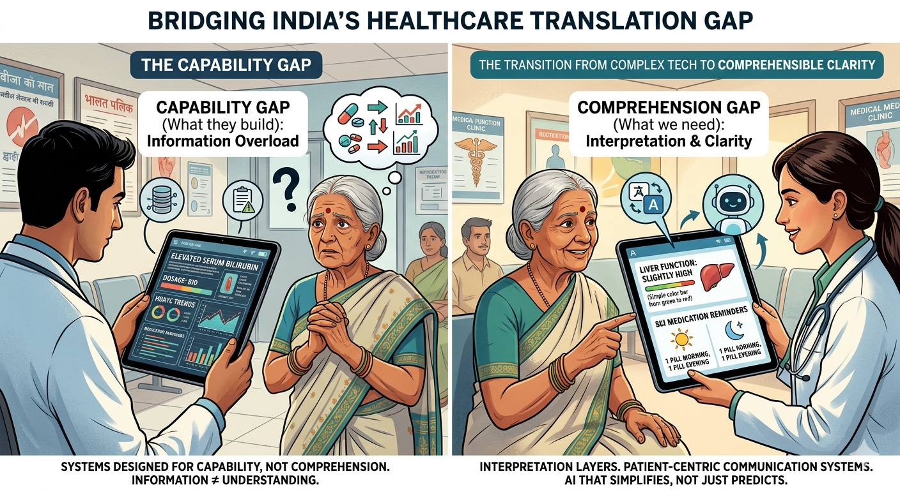

### M.Pharm (Pharmacy Practice) Scholar · RIPER · Medical Writing · Clinical Research · Digital Health

  
  
  
  
  

---

## 👋 About Me

I am an **M.Pharm (Pharmacy Practice)** scholar at the **Raghavendra Institute of Pharmaceutical Education and Research (RIPER)**, Anantapur (JNTUA), and I live in **Koppal, Karnataka**.

My work sits across **clinical research, evidence synthesis, medical writing and healthcare communication** — reading dense clinical material carefully and turning it into language that patients and practitioners can actually use.

As the founder of **TechStudyHubCore**, I build systems to solve real healthcare-education problems rather than software for its own sake.

> 🎯 **The 10-year vision:** close the distance between healthcare knowledge and healthcare outcomes — making clinical information accessible, localised and actionable.

---

## 🧠 The Gap I Work On

Two failures I keep running into in healthcare delivery:

1. **The Capability Gap** — health systems produce enormous volumes of evidence-based material, which arrives as information overload rather than understanding.
2. **The Comprehension Gap** — at the point of care, patients need immediate, simple and culturally synchronised guidance to stay adherent and manage chronic conditions.

> **Working hypothesis:** technology-assisted, vernacular, visual-first communication can measurably improve adherence and reduce avoidable re-hospitalisation.

---

## 🛠️ What I Actually Do

### Clinical & scientific work

- Literature review and evidence synthesis
- Structured medical writing and research documentation
- Patient-counselling and health-literacy content
- Telepharmacy concepts and digital-health engagement

### AI orchestration — not software engineering

I'm not a computer-science specialist, and I don't write production code as a discipline. What I do is **direct LLM models across the whole build lifecycle** and own the architecture around them:

- **Idea → plan → design → build → deploy → host**, driven end to end
- Prompt design and deterministic prompt structures
- Directing models to produce, review and refine the code
- Live hosting and delivery: domains, subdomains, multi-page routing (`/` paths)
- No-code automation and structured content workflows

The judgement being applied is about *what to build and why* — and keeping the result coherent — not about writing the syntax myself.

### Languages (a clinical asset)

Kannada (native) · English (professional) · Hindi · Telugu · Tamil — strong vernacular patient-communication capability.

---

## 🚀 Current M.Pharm Focus (planned research artifacts)

- 📊 **Artifact 1** — Healthcare Communication Gap Assessment Tool (quantifying where clinical intake drops off)
- 📱 **Artifact 2** — Visual Patient Counselling Dashboard (localised, multi-dialect interfaces)
- 📈 **Artifact 3** — Clinical Outcome Improvement Study (vernacular delivery measured against recovery metrics)
- 🧮 **Artifact 4** — Medication Adherence Support Model (effect of clearer, localised counselling on adherence)

---

## 🎓 Education

| Programme | Institution | Period |
|---|---|---|
| **M.Pharm — Pharmacy Practice** | RIPER, Anantapur (JNTUA) | Aug 2026 – present |
| **B.Pharm** | Priyadarshini College of Pharmacy, Koratagere (RGUHS) | 2021 – 2025 · CGPA 7.2 / 10 |
| **Pre-University (PCMB)** | Satyam International School & PU College, Ballari | 2018 – 2020 · 81.45% |

---

## 📜 Certifications

- **AI in Pharma: Transforming Life Sciences Through Technology** — LSSSDC · Skill India · NSQF Level 5 (Mar 2026)
- **Generative AI Mastermind** — Outskill (Dec 2025)
- **Google AI Essentials** — Google / Coursera
- **Google Prompting Essentials** — Google / Coursera
- **Use AI as a Creative or Expert Partner** — Google / Coursera
- **Good Clinical Practice** — NIDA Clinical Trials Network
- **Junior Medical Writing Intern** — YuvaIntern (certificate of experience)

---

## 🔬 Research & Projects

- **Telepharmacy — Comparative Literature Review (2025):** *"Patient Satisfaction and Counseling Effectiveness in Telepharmacy: A Comparative Literature Review of Remote vs. Face-to-Face"* — RGUHS final-year dissertation.
- **Research presentation — PharmaNEST 3.E International Conference, Ooty (2022):** nanoparticle drug-delivery systems; recognised as an award recipient.
- **TechStudyHubCore — Founder & Platform Architect (2026 – present):** a live health-education platform for pharmacy and nursing students, including the **S.M.I.L.E. Framework** built for Kannada-first learners.

---

## 📈 GitHub Metrics

  
  

---

## 🤝 Connect With Me

Let's talk about clinical communication, vernacular health education, or building patient-facing systems.

  
  
  

